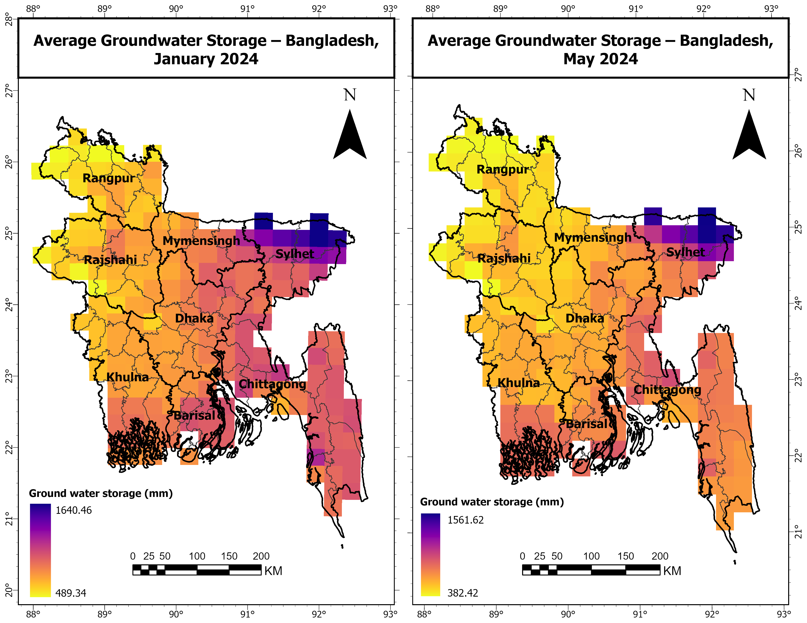
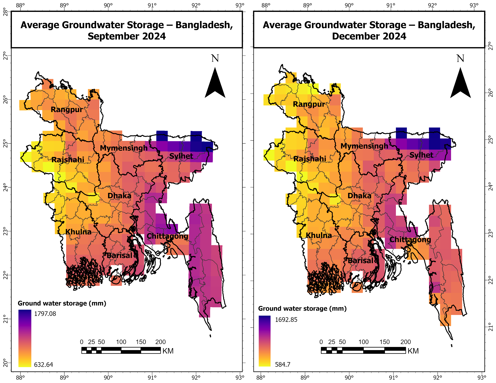

# Groundwater Storage Dynamics in Bangladesh, 2024

Monthly and seasonal patterns of groundwater storage across the divisions of Bangladesh in 2024, using NASA's GLDAS-2.2 land surface model (with GRACE satellite data assimilation) in Google Earth Engine.

## Objective
To describe how groundwater storage changes through the year in Bangladesh, and which divisions experience the largest seasonal swings between the dry season and the monsoon.

## Data
| Dataset | Source | Details |
|---|---|---|
| GLDAS-2.2 CLSM, GRACE data assimilation (`GWS_tavg`) | NASA GES DISC, via Google Earth Engine (`NASA/GLDAS/V022/CLSM/G025/DA1D`) | Daily, 0.25° (~27.8 km), groundwater storage in mm of water |
| Division boundaries | FAO GAUL 2015, Level 1 (simplified 500 m) | Administrative divisions |

## Method
All processing was done in Google Earth Engine (`gee/bd_groundwater_gldas_2024.js`):

1. **Data:** Daily groundwater storage (`GWS_tavg`) for January–December 2024 was loaded for Bangladesh.
2. **Monthly composites:** Daily values were averaged into 12 monthly mean images.
3. **Division time series:** The mean storage of each division was extracted for every month and plotted as a time series.
4. **Seasonal amplitude:** For each grid cell, the seasonal amplitude was calculated as the difference between the highest and lowest monthly storage. Division averages of annual mean storage and amplitude were then compared.
5. **Seasonal maps:** Storage was mapped for January (early dry season), May (end of dry season), September (late monsoon), and December (post-monsoon) on one common colour scale, so the maps can be compared directly.
6. **Export:** The division-by-month table was exported as CSV and the monthly and amplitude rasters as GeoTIFFs.

## Results

**Seasonal maps**

**Division summary**

| Division | Annual mean storage (mm) | Seasonal amplitude (mm) |
|---|---|---|
| FILL FROM `data/gws_division_summary_2024.csv` | | |

Key findings:
- Groundwater storage declined through the dry season, reaching its lowest point in **[month]**, and rose sharply with the monsoon, peaking between **July and October**.
- **Sylhet** had the highest storage throughout the year.
- **Khulna** and **Rajshahi** showed the largest seasonal swings meaning their groundwater depends strongly on monsoon recharge.

## How to Reproduce
1. Open the script in the Earth Engine Code Editor: [Open in GEE](PASTE_GET_LINK_HERE)
   or paste `gee/bd_groundwater_gldas_2024.js` into the [Code Editor](https://code.earthengine.google.com/).
2. Run it. All data comes from the public Earth Engine catalog, so no uploads are needed.
3. The Console shows the time series chart, the division summary, and the colour scale used for the maps.
4. Export the CSV tables and rasters from the Tasks tab.

## Limitations
- **One year only:** this shows seasonal dynamics in 2024, not a long-term trend. Detecting depletion or recovery needs a multi-year record (GLDAS-2.2 starts in 2003).
- **Modelled, not observed:** groundwater storage comes from a land surface model constrained by GRACE satellite gravity data, not from observation wells.
- **Coarse resolution:** at 0.25°, each division contains only a limited number of grid cells, and GRACE's own resolution is much coarser (a few hundred km), so local differences within divisions are not resolved.

## Author
**Mabrook**, Department of Urban & Regional Planning, Khulna University of Engineering & Technology (KUET)
✉️ mkmabrook7@gmail.com
